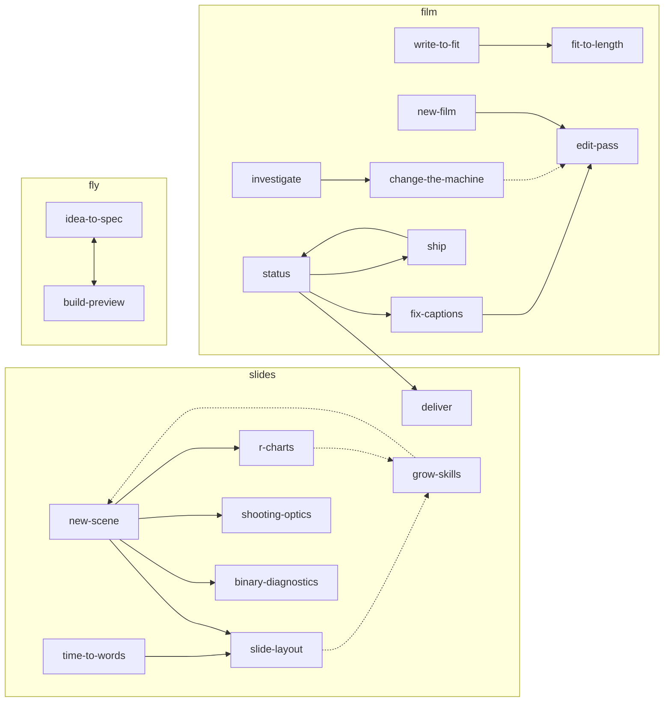

# 01 — Inventory for an optimization loop (DSPy / GEPA)

2026-10-08, at HEAD 728051a, read-only. Nothing in the repo was changed except
this new file. Every number says whether it was **measured** (a command, listed
in the last section) or **reasoned** (an estimate from sizes and prices).

## First lines: what does not fit the brief

1. **Some of what the brief names does not exist.** There is no `.claude/agents/`
   and no `.claude/commands/`. No skill has sub-skills or workers. The code
   makes no LLM API call. The one place the code reaches an LLM is
   `film/ffilm/guide.py:871`: FILM.bat's [C] option starts an interactive
   `claude` in the repo root. That is a person talking to Claude, not a prompt
   that can be optimized.
2. **dspy / gepa / mlflow are new dependencies** (agreement 11: "No new
   dependency"). They resolve for this machine's Python, but they bring 124
   packages (§8). They would have to live outside film/, slides/ and fly/.
3. **There is no LLM endpoint for an optimizer.** `ANTHROPIC_API_KEY` and
   `OPENAI_API_KEY` are not set, and the `ant` CLI is not installed (measured).
   DSPy calls models through litellm, which needs a key. The only model access
   here is Claude Code 2.1.281 (`claude -p`, on the subscription). Using it from
   DSPy would need an adapter written for it.
4. **The data is thin.** The repo's skills were called 53 times in 63 sessions
   (2026-09-08 → 2026-10-08), and 23 of those calls were change-the-machine
   (§2). edit-pass, "the everyday loop", was called 3 times. No ratings of
   outputs exist anywhere (§5).
5. **03-plan.md depends on 02-decisions.md**, which is Jacek's to write. The
   questions it must answer are at the end of this file.

## Sources read

docs/OPEN.md; the memory index and the notes ideas-not-built, user_simplicity,
lean-means-the-film-code and no-redesigns; all 6 CLAUDE.md files; all 19
SKILL.md files; `.claude/settings.json` and `settings.local.json`; the 5 hooks
in `film/.claude/hooks/`; `.githooks/`; the 3 pyproject.toml files; 363 commits;
the 63 session transcripts in `~/.claude/projects/C--Users-jacek-code-ai-*`.

Searched before writing: qmd `v2` and `v2-history` (dspy, gepa, mlflow, eval,
judge, prompt optimization: nothing on the subject), `aimanim.patterns find
optimiz` and `find judge` (nothing), `git log --grep` (nothing). Found
elsewhere: the claude-api skill that ships with Claude Code has `build-eval`
and `hillclimb` guides (an eval set, a train/validation/test split, a report).
They do this job without DSPy or GEPA.

---

## §1–2 The optimizable text: what each piece is, how often it runs, who calls it

### Instructions (CLAUDE.md files)

| file | role | loaded when | size (measured) |
|---|---|---|---|
| `CLAUDE.md` | the 13 agreements, commands, where things are | every session | 5,218 B |
| `film/CLAUDE.md` | film stage: the one rule (edit film.yaml, not ffilm/), roles, skill table, qmd rules | Claude reads a file under film/ | 7,477 B |
| `projects/CLAUDE.md` | the editor: what may be touched, taste defaults | a file under projects/ | 4,045 B |
| `film/ffilm/CLAUDE.md` | the developer: standing requests, layers, code rules | a file under film/ffilm/ | 6,130 B |
| `slides/CLAUDE.md` | slides stage: narration first, scene rules, commands | a file under slides/ | 8,835 B |
| `fly/CLAUDE.md` | fly stage: render rules, Blender gotchas | a file under fly/ | 2,769 B |

They are not run on their own. They shape every answer, so no single test
measures them.

### Skills (`.claude/skills/*/SKILL.md`, 19)

"Calls" = Skill-tool calls in the 63 transcripts (measured). A skill can also
be followed without a Skill call (Claude reads the file: 26 direct Reads
counted), so calls are a lower bound.

| skill | stage | does | input | output | calls | started by | model pin | size |
|---|---|---|---|---|---|---|---|---|
| write-to-fit | film | notes + photos → 3 texts inside a word budget | notes, contact.jpg, old texts | script_intro.txt, narration.txt, script_outro.txt (never over a non-empty one), write-to-fit_DATE.txt | 1 | "write the script" | sonnet | 5.2 kB |
| new-film | film | media/ → a first film.yaml | media/, analysis/ | film.yaml, a "first cut" commit, peek | 0 | "start", "first cut" | — | 2.7 kB |
| edit-pass | film | notes on a render → small film.yaml edits | his notes, film.yaml | film.yaml edits, peek/draft, one report line per note | 3 | any note on pacing, order, moves or captions | sonnet | 3.4 kB |
| fit-to-length | film | cut a film to a length by dropping repetition | film.yaml, transcript.txt, `film check` | a proposal table, then cuts after his "go" | 2 | "make it a Short" | — | 4.2 kB |
| fix-captions | film | put captions on the speech measured in the audio | film.yaml, transcript, silencedetect | caption `at`/`dur`/`words` | 2 | "the caption disappeared" | sonnet | 4.0 kB |
| ship | film | the final render and thumbnail | film.yaml | out/final.mp4 | 3 (+2 typed /ship) | only /ship | `disable-model-invocation` | 1.9 kB |
| status | all | where a film stands, one next step | all three stages' files | a report (read-only) | 3 | "where am I" | sonnet | 4.2 kB |
| investigate | film | find a fault's cause before fixing | a symptom | measurement, mechanism, proposal | 5 | "sounds wrong", "is slow" | opus | 2.8 kB |
| change-the-machine | film | change ffilm/ | his explicit ask | a sentence-named test, the fix, a commit | 23 | an explicit code ask | opus | 2.6 kB |
| new-scene | slides | a problem in words → one slide | his words | spec.md, scene.py, still, slides.txt line | 4 | "make a slide about" | — | 4.5 kB |
| slide-layout | slides | the craft rules and commands for any scene | a scene | fixes; loaded by new-scene, time-to-words | 4 | before any scene.py | — | 6.6 kB |
| time-to-words | slides | time each animation to his narration | film.yaml captions | timing.json, clips/, `clip:` lines | 2 | "narrated" | — | 2.3 kB |
| deliver | slides | where slides and clips are, and whether they are current | the project | a report | 0 | "is it in the film" | — | 1.1 kB |
| grow-skills | slides | a step done twice → a command, helper or skill | the session | a new tool | 0 | end of a film | — | 5.0 kB |
| r-charts | slides | a ggplot chart with Manim callouts | data | PNG, panel JSON, scene | 0 | "ggplot", "R" | — | 3.9 kB |
| binary-diagnostics | slides | checked numbers for yes/no tests (a reference) | — | numbers, drawings | 0 | a test, false positives | — | 8.1 kB |
| shooting-optics | slides | checked numbers for sights (a reference) | — | numbers, drawings | 1 | sights, MOA, mil | — | 11.2 kB |
| idea-to-spec | fly | idea.md → stops.json or spec.md | idea.md | a spec | 0 | a new 3D project | opus | 1.1 kB |
| build-preview | fly | spec → stills → video | the spec | preview/, out/ | 0 | after idea-to-spec | sonnet | 1.1 kB |

The 19 descriptions together are 6,931 characters (measured). They are in the
context of every session; that is the routing text.

### LLM prompts in code

None. `grep` for anthropic, openai, dspy, litellm, ollama, `claude -p` and
messages.create over *.py, *.bat, *.sh, *.toml and *.R found only guide.py's
`shutil.which("claude")` and `subprocess.run(["claude"])` (measured).

---

## §3 Structure and the call graph

- **No orchestrators.** No skill starts a subagent. In the transcripts there are
  4 subagent calls in total (2 Plan, 2 zz-model-test), none from a skill
  (measured).
- **Routing, three layers:**
  1. Claude Code matches the message against the 19 descriptions.
  2. film/CLAUDE.md and slides/CLAUDE.md each have a "use it when" table: a
     second router, read when Claude is in that stage.
  3. For people, SLIDES.bat, FILM.bat (guide.py's menu) and FLY.bat.
- `ship` can only be started by Jacek (`disable-model-invocation: true`).
- Leftover empty folders from the merge: `film/.claude/skills/`,
  `slides/.claude/skills/`, `fly/.claude/skills/`, `fly/skills/`.

Edges = one skill names another in its text (measured with grep):



Solid = "load / go on to"; dotted = "mentions".

---

## §4 The pipeline: what makes the film, what changes the code

| makes film output | what it produces |
|---|---|
| write-to-fit | the texts he reads (his words; agreement 1) |
| new-film, edit-pass, fit-to-length, fix-captions | film.yaml: order, durations, moves, cuts, captions |
| ship | out/final.mp4 and the thumbnail |
| new-scene, slide-layout, r-charts, binary-diagnostics, shooting-optics | spec.md, scene.py, stills |
| time-to-words | clips timed to his words |
| idea-to-spec, build-preview | the 3D flight |
| status, deliver | reports only |

| changes the machine | |
|---|---|
| change-the-machine, investigate | ffilm/ code and tests |
| grow-skills | new commands, helpers, skills |
| the CLAUDE.md files | the rules every session follows |

---

## §5 Evaluation signals that already exist

| signal | what it says | measured today |
|---|---|---|
| film suite (`pytest`) | every rule that broke once | **1054 passed** in 24.3 s |
| slides suite (`unittest`) | aimanim helpers | **97 OK**, 3 skipped |
| fly suite | fly helpers | **16 OK** |
| `film check` (checks.py) | broken file, unused media, framing risk, captions under 1.2 s, repeated and paraphrased captions, caption share, total length | runs after every film.yaml edit (check_film hook) |
| `aimanim.look still` | `[layout]` notes, pixel-margin PROBLEMs | |
| `aimanim.film <film> check` | each step's word rehearsed against the script | pre-commit `--gate` |
| `slides/.local/renders.csv` | per render: scene, kind, seconds, notes, issues | 32 rows since 2026-10-07 |
| ffprobe | lengths (clip vs slide within 2 frames) | |
| Jacek's verdicts | OPEN.md "Fixed": a quote per entry ("captions look right now", "it is ok") | text, not scores |
| the transcripts | his notes and corrections | 848 typed lines in 63 sessions |
| memory feedback notes | named failures: answer-short, his-words-never-cut-silently, measure-before-claiming, no-redesigns, walk-the-path-as-the-user | rubric items for a judge |

**Not found: any rating or score of an output.** A judge calibrated "against
my ratings" needs those ratings made first.

---

## §6 Replayable task → fix pairs in git (measured)

| for | pairs | the task | the oracle |
|---|---|---|---|
| change-the-machine | **126** commits change `ffilm/` and a `tests/test_*` together | the test's name, a sentence | the suite (24 s) |
| edit-pass, new-film, fit-to-length, fix-captions | **90** same-file film.yaml before→after pairs (136 changes) | **not in git**: his note is only in the transcripts | `film check`, then his eye |
| new-scene, slide-layout | 14 commits touch scenes; 22 scene folders | spec.md | `look still` notes |
| fly skills | 18 commits | idea.md | his eye on stills |
| the instructions themselves | SKILL.md 31 commits, CLAUDE.md 48, OPEN.md 83 | the fault in OPEN.md | — |

The 90 is an upper bound. Every render commits film.yaml, and `film go` or
`init` rewrites it, so many pairs are not one note → one edit.

Routing labels (measured): **48** Skill calls have a typed message just before
them, spread over 12 skills. change-the-machine has 23 of them; 7 skills have
none. Negatives (messages that should start no skill) are plentiful: 848 typed
lines.

---

## §7 What stays outside optimization (safety-critical)

An optimizer may never rewrite these:

- **Permissions and hooks:** `.claude/settings.json` (allow list, the 6 hooks),
  `.claude/settings.local.json` (`defaultMode: bypassPermissions`),
  `film/.claude/hooks/*.py` (guard_media, check_film, run_tests, commit_gate,
  long_session), `.githooks/pre-commit` and `post-commit`.
- **Who may start what:** `disable-model-invocation: true` on ship; the
  `model:` pins (they set cost).
- **The rules that came from damage:** root CLAUDE.md agreements 1–13; every
  skill's "Never" section; projects/CLAUDE.md "What you may touch";
  ffilm/CLAUDE.md "Standing requests" and "The layers"; film/CLAUDE.md "Never".
- **Paths an eval run must never write:** `projects/*/media/`,
  `narration.txt`, `script_*.txt`, `out/final.mp4`, `models/`,
  `film/ffilm/audio.py`.
- **Commands an eval run must never run:** `film final`, `aimanim.film … publish`,
  full-size `clips`, `git commit` on main.
- **Rule for any eval:** it works on copies of projects (as
  `projects/zz_redo_test` was made), never on a real film.

---

## §8 Python environment, and whether dspy / gepa / mlflow can be added

| | measured |
|---|---|
| uv | 0.12.8 |
| Python | 3.13.5 (film/.venv, slides/.venv; fly runs `--no-project`, stdlib) |
| film/.venv | numpy 2.5.2, pytest 9.1.1 (+ opencv, pillow, pyyaml) |
| slides/.venv | manim 0.21.0, numpy 2.5.3 |
| dspy, gepa, mlflow, litellm, anthropic | installed nowhere |
| disk C: | 40 GB free (92 % used) |

Resolved with `uv pip compile` for Python 3.13 on Windows, in the scratchpad.
Nothing was installed.

| asked for | resolves | packages | brings |
|---|---|---|---|
| dspy | yes, dspy 3.4.0 | 67 | gepa 0.1.4 (already inside), litellm, openai, boto3, huggingface-hub, pydantic |
| gepa alone | yes, 0.1.4 | 1 | — |
| mlflow | yes, mlflow 3.17.0 | 89 | flask, fastapi, sqlalchemy, pandas 3.0.6, scipy, pyarrow |
| all three | yes | **124** | |

So, technically: yes. Under the rules: only in a folder of its own, with its
own pyproject.toml and lock (for example `opt/`), so that film/, slides/ and fly/
keep their dependencies. mlflow is 89 of the 124. A CSV log like
`slides/.local/renders.csv` does what the loop needs from it.

---

## §9 The two best candidates: other structures, cost per run

Prices (claude-api skill, cached 2026-10-06), per million tokens:
Opus 5.5 $4 in / $20 out, Sonnet 5.5 $2 / $10, Haiku 5.5 $0.10 / $0.50, cache
reads $0.20.

**What an agentic run costs here (measured from the 10 sessions in this
repo):** 618 M cache-read, 7.8 M cache-write and 2.5 M output tokens over 90
typed prompts. That is 6.9 M cache-read and 28 k output per prompt: about **$1.9
per prompt** at Opus 5.5 list prices, before cache writes. On the subscription
it is quota, not dollars; through an API key it would be dollars.

GEPA scores many candidate texts, each over the whole training set. So the
cost per pass below gets multiplied by the number of passes GEPA's budget
allows. That number is not measured here.

### Candidate 1 — skill routing (the 19 descriptions)

What it decides: which skill (or none) a message starts.
Data: 48 labelled messages + negatives from the 848 typed lines.
Hard check: exact match.

| structure | what it is | cost per pass over ~96 cases |
|---|---|---|
| A. flat (now) | 19 descriptions, 6,931 chars, always in context | one API call per case, ≈2 k tokens in: Haiku ≈ $0.02, Sonnet ≈ $0.40 (reasoned) |
| B. three stage routers | one router SKILL.md per stage (slides, film, fly), its sub-skills as files it reads | same as A, plus one Read per run (≈1–2 k tokens) when used for real (reasoned) |
| A or B through `claude -p` | the real Claude Code system prompt around it | ≈ $1–8 per pass, depending on caching (reasoned; the system prompt was not measured) |

Why B: shorter text in every session, and stage words ("slide", "film",
"flight") route first.
Against B: two hops; a sub-skill file cannot be started by the Skill tool
directly; and the stage CLAUDE.md tables already do this job.
**Not known:** whether routing fails today. No miss has been counted.

### Candidate 2 — edit-pass (notes → film.yaml)

What it decides: the smallest film.yaml edit for each note.
Hard checks: `film check` OK; only the shots the note names change; no
`from:`/`to:` replaced; no move family twice in a row (`moves.FAMILY`); the
captions' `words:` untouched.
Data: the 90 film.yaml pairs, joined to the notes in the transcripts (count
after the join: not measured).

| structure | what it is | cost per case |
|---|---|---|
| A. monolithic agentic skill (now) | Claude Code reads, edits, runs `film check` and peek | ≈ $1.9 (the measured average above) + a peek render; 30 cases ≈ $57 per pass |
| B. router + sub-skills | edit-pass sorts each note: captions → fix-captions, length → fit-to-length, pacing and moves → itself | like A; the existing skills become its sub-skills |
| C. one call + an applier | "note + film.yaml → YAML patch + report line" as one call; Claude Code only applies the patch, checks and peeks | ≈7 k tokens in / 0.8 k out: Sonnet ≈ $0.02 + a judge ≈ $0.02 → ≈ $1.2 per 30-case pass (reasoned) |

Only C lets GEPA score a candidate without running Claude Code. Its weakness: C
is a stand-in for the real skill. Whether C's score predicts A's result has to
be measured on a few cases first (in 03).

### Named, not in the top 2

- **change-the-machine** has the best oracle (126 pairs, a suite in 24 s) and is
  the most used skill (23 calls). But it is code work, and every case is an agentic
  run (≥ $1.9 each, reasoned).
- **fit-to-length** and **write-to-fit** work on his words (agreement 1). An
  optimizer would be learning to change them. There are 1–3 real cases each
  (Bauhaus 281.8 → 171.6 s; one write-to-fit record on disk).

---

## Closing table

| artifact | type | current structure | eval signal | dataset source | cost per eval pass | priority |
|---|---|---|---|---|---|---|
| 19 skill descriptions | routing text | flat, 6,931 chars | Y: exact match | 48 labelled Skill calls + negatives from 848 typed lines | $0.02 (Haiku) – $0.40 (Sonnet); $1–8 via `claude -p` | 1 |
| edit-pass | skill, film output | monolithic, agentic | Y: `film check` + diff rules; N: "did it answer the note" needs a judge | 90 film.yaml pairs + notes from transcripts | ≈ $1.2 (one-call stand-in) / ≈ $57 (agentic, 30 cases) | 2 |
| change-the-machine | skill, code | monolithic, agentic | Y: the suite | 126 test+fix commits | ≥ $1.9 per case, agentic | 3 |
| fit-to-length | skill, film output | monolithic | Y: length from `film check`, cuts at sentence ends | 1–3 real cuts | ≈ $0.09 per case, one call, Opus (reasoned) | 4 (his words) |
| new-scene + slide-layout | skills, slides | new-scene loads slide-layout | Y: `[layout]` notes, margins, rehearsal | 22 scenes, 32 renders logged | agentic + a Manim render per case (5–43 s per scene, measured) | 5 |
| fix-captions | skill, film output | monolithic | Y: caption length ≥ 1.2 s, `words:` kept | ~4 caption commits | ≈ $0.03 per case, one call (reasoned) | 6 |
| write-to-fit | skill, film output | monolithic | partly: word count, words/s (2 films measured) | 1 record + 21 narration.txt | ≈ $0.05 per case, one call with a picture (reasoned) | 7 (his words) |
| CLAUDE.md files (6) | instructions | root + 5 nested | N: not testable alone | — | — | 8 |
| status, deliver | skills, reports | read-only | Y: facts on disk | any film | ≈ $0.02 per case (reasoned) | low |
| idea-to-spec, build-preview | skills, fly | two steps | N: stills judged by eye | 17 flights | a Blender render per case | low |
| ship | skill, final render | user-only | — | — | — | excluded |
| settings, hooks, git hooks | safety | — | — | — | — | excluded (§7) |

---

## Questions for 02-decisions.md

1. **Dependencies.** None, or a separate `opt/` folder with dspy (67 packages)?
   With or without mlflow (+89)?
2. **Model and credentials.** An API key (real dollars), or `claude -p` on the
   subscription (needs an adapter, uses quota)?
3. **Budget.** A monthly ceiling in dollars or in sessions.
4. **Targets.** Which 1–2: routing, edit-pass, change-the-machine, or none yet?
5. **Who changes a skill.** May an optimizer write a SKILL.md, or only propose a
   diff for you to read?
6. **Your words.** Are write-to-fit and fit-to-length out of scope?
7. **Ratings.** Will you rate outputs (how many, in what form) for the judge to
   be calibrated on?
8. **Or the smaller route.** Does the claude-api skill's `build-eval` /
   `hillclimb` guide (no GEPA) do enough?

---

## Commands behind the measured numbers (run from the repo root)

```
git log --oneline | wc -l                                   363 commits
wc -c CLAUDE.md */CLAUDE.md film/ffilm/CLAUDE.md .claude/skills/*/SKILL.md
uv run --directory film --extra dev pytest -o addopts="" -q -p no:warnings      1054 passed
uv run --directory slides python -m unittest discover tests                     97 OK (3 skipped)
uv run --directory fly --no-project python -m unittest discover tests           16 OK
uv run --directory slides python -m aimanim.look stats                          32 renders
uv pip compile <req.in> --python-version 3.13 --python-platform windows         (scratchpad)
```

Counted with grep/awk over `git log --name-only` (the §6 pairs), over the 63
`.jsonl` transcripts (Skill calls, Reads, subagents, token usage), and with a
read-only script in the session scratchpad (the 48 routing labels).
